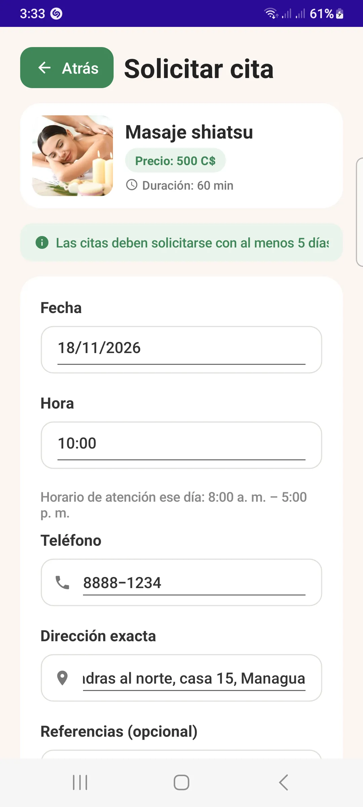
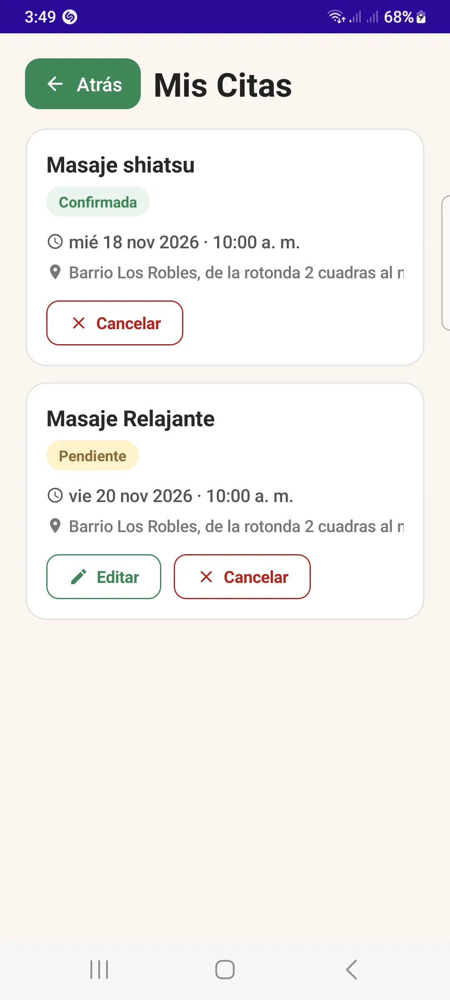
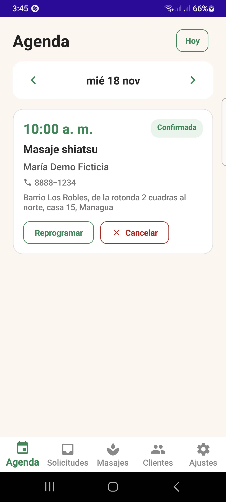
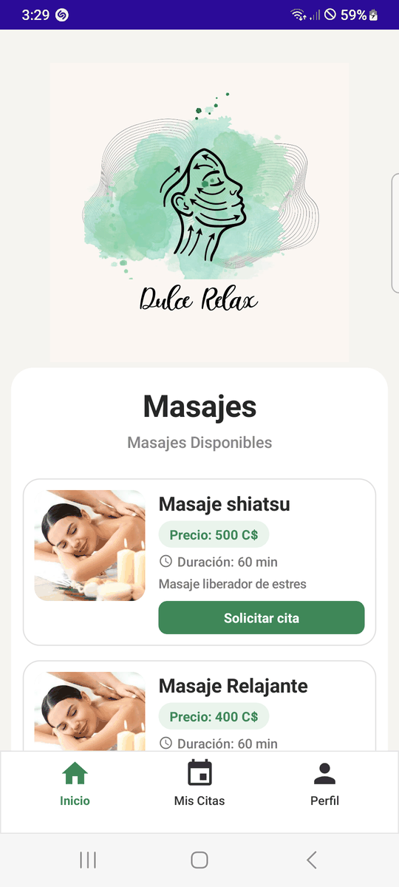
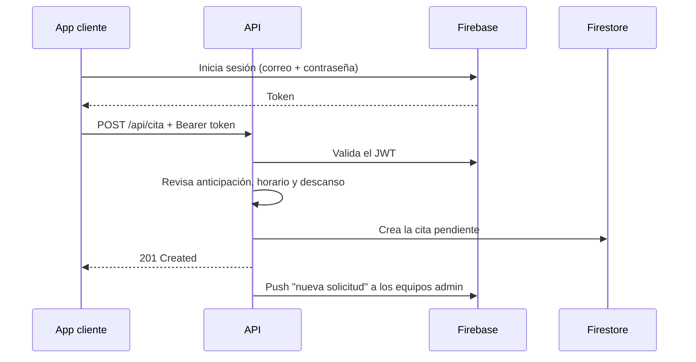

# DulceRelax

Sistema para agendar masajes a domicilio: una API REST en ASP.NET Core y dos
aplicaciones .NET MAUI (cliente y administrador), con autenticación de Firebase,
modo sin conexión y notificaciones push.

[Español](README.es.md) · [English](README.md)

## Descripción

El cliente pide una cita eligiendo masaje, fecha, hora y dirección. El administrador la
confirma, la reprograma o la cancela desde su agenda diaria. La API es dueña de las
reglas de negocio; las dos apps las consumen.

Es un producto completo, no un CRUD de ejemplo: autenticación, permisos por rol, modo
sin conexión, recordatorios locales, notificaciones push y una API desplegada. Yo
construí la API, el modelo de datos y las reglas, e implementé los dos clientes MAUI
sobre ese flujo.

## Características

### App cliente

- Registro e inicio de sesión con correo y contraseña, y recuperación de contraseña.
- Catálogo de masajes con precio, duración y descripción.
- Solicitud de cita con dirección exacta, teléfono y un detalle para ubicar la casa.
- Edición de citas pendientes y cancelación.
- Consulta de "Mis citas" con estados pendiente, confirmada y cancelada.
- Perfil del usuario, con edición de nombre, teléfono y dirección.

### App administrador

- Inicio de sesión restringido a cuentas con el claim `admin`.
- Agenda por día, con navegación al día anterior, al siguiente y un atajo a hoy.
- Confirmación o cancelación de solicitudes pendientes.
- Alta y edición de masajes, incluida la disponibilidad.
- Listado de clientes.
- Configuración del horario de atención por día de la semana.
- Trabajo sin conexión con las citas confirmadas que ya se descargaron en el equipo.
- Avisos por notificación cuando el cliente pide una cita o la cancela.
- Aviso cuando una solicitud sigue sin confirmar cerca de la fecha de la cita.

## Capturas

<p align="center">
  
  
  
  
</p>

<p align="center">
  
</p>

Las apps están solo en español. Las capturas se tomaron de una compilación de depuración
en Android con datos ficticios; la lista de captura vive en
[`docs/screenshots`](docs/screenshots/README.md).

## Tecnologías

| Capa | Tecnología |
| --- | --- |
| API | ASP.NET Core 9 Web API, Firebase Admin SDK |
| Autenticación | Firebase Authentication (JWT) |
| Datos | Cloud Firestore |
| Apps | .NET MAUI 9 (Android), CommunityToolkit.Mvvm |
| Sin conexión | SQLite en la app de administrador |
| Push | Firebase Cloud Messaging |

## Arquitectura

El repositorio es una solución de cuatro proyectos:

| Proyecto | Tipo | Responsabilidad |
| --- | --- | --- |
| `DulceRelax.API` | ASP.NET Core Web API | Controladores REST, Firestore, reglas y push |
| `DulceRelax.Shared` | Biblioteca | DTOs, `CitaRules` y configuración compartida de la API |
| `DulceRelax.App.Cliente` | .NET MAUI | App del cliente |
| `DulceRelax.App.Admin` | .NET MAUI | App del administrador |

Las apps no comparten interfaz. Cada una tiene su propia capa de servicios
(`Services/`), modelos de vista (`ViewModels/`) y vistas (`Views/`), y reutiliza los
DTOs y las reglas de `DulceRelax.Shared`.



El flujo de una petición pasa por una app, la API y Firestore. Firebase Authentication
emite los tokens, la API valida el JWT contra el proyecto de Firebase y Firestore guarda
los datos.

## Reglas de negocio

Las reglas viven en `DulceRelax.Shared/CitaRules.cs` y están cubiertas por pruebas
unitarias.

- Una cita debe pedirse con al menos 5 días de anticipación.
- Entre dos citas confirmadas debe quedar una hora de descanso.
- La hora solicitada debe caer dentro del horario de atención del día, medido en la zona
  horaria del negocio.
- La duración sale de los minutos del masaje. Si falta el dato, se usan 60 minutos.
- El cliente solo edita citas pendientes y solo puede cancelar.
- El horario debe incluir los 7 días.

La API es la fuente de verdad. El cliente repite la anticipación y el horario solo para
avisar antes de enviar la solicitud.

## Requisitos previos

- SDK de .NET 9.0 o posterior.
- Carga de trabajo de MAUI: `dotnet workload install maui-android`.
- SDK de Android y un emulador o dispositivo.
- Un proyecto de Firebase con Authentication por correo, Firestore y Cloud Messaging.

## Configuración

### API

La API lee los valores de Firebase de la configuración. En desarrollo, usa user secrets:

```bash
cd DulceRelax.API
dotnet user-secrets set "Firebase:ProjectId" "<tu-project-id>"
dotnet user-secrets set "Firebase:CredentialsJson" "$(cat /ruta/a/serviceAccountKey.json)"
dotnet user-secrets set "Firebase:WebApiKey" "<tu-web-api-key>"
```

| Clave | Uso |
| --- | --- |
| `Firebase:ProjectId` | Proyecto de Firebase, emisor y audiencia del JWT. |
| `Firebase:CredentialsJson` | JSON de la cuenta de servicio para Firestore y Firebase Admin. |
| `Firebase:WebApiKey` | Inicio de sesión, recuperación de contraseña y refresco del token. |
| `Negocio:ZonaHoraria` | Zona horaria del negocio. Por defecto, `America/Managua`. |

El `.gitignore` ya excluye `serviceAccountKey.json`, `firebase-adminsdk*.json`,
`appsettings.Development.json`, `appsettings.Local.json`, `google-services.json`,
`GoogleService-Info.plist`, `*.keystore` y `*.jks`. No subas credenciales al repositorio.

### Rol de administrador

La API autoriza el rol con una política `Admin` que exige el claim `admin` con valor
`true`. La app de administrador también comprueba ese claim antes de dejar entrar. El
claim se asigna en la cuenta de Firebase; el sistema no incluye un endpoint que lo cree.

### Apps MAUI

La dirección base de la API está centralizada en `DulceRelax.Shared/ApiSettings.cs`. En
Debug apunta a `http://10.0.2.2:5082/` (el equipo anfitrión desde el emulador de Android)
y en Release a `https://dulcerelax.onrender.com/`. También se puede sobrescribir en
tiempo de ejecución con la preferencia `api_base_url`.

Los `ApplicationId` son:

- `com.bryanrf22.dulcerelax.cliente`
- `com.bryanrf22.dulcerelax.admin`

### Firebase Cloud Messaging (app de administrador)

1. En la consola de Firebase, agrega una app de Android con el paquete
   `com.bryanrf22.dulcerelax.admin`.
2. Descarga el `google-services.json` y cópialo en la raíz de `DulceRelax.App.Admin/`.
   El archivo no se versiona.
3. Habilita la API de Firebase Cloud Messaging. La cuenta de servicio de la API es la
   que envía los avisos.

El `.csproj` incluye el archivo como `GoogleServicesJson` y avisa con un warning cuando
no está. Sin ese archivo la app compila, pero Firebase no se inicializa y no llegan los
avisos.

La app se registra sola en la API al iniciar sesión: `PushService` pide el token de FCM
y lo manda a `POST api/dispositivo`. Al cerrar sesión, el token se da de baja.

## Cómo ejecutar

API:

```bash
dotnet run --project DulceRelax.API
```

El perfil `http` escucha en `http://localhost:5082` y el perfil `https` en
`https://localhost:7204;http://localhost:5082`. En desarrollo, la API expone el
documento OpenAPI. Los pasos de despliegue para Render y Fly están en
[`docs/deployment.md`](docs/deployment.md).

Apps MAUI:

```bash
dotnet build DulceRelax.App.Cliente -f net9.0-android
dotnet build DulceRelax.App.Admin -f net9.0-android
```

### Pruebas

```bash
dotnet test DulceRelax.Tests
```

El proyecto cubre las reglas de negocio: anticipación, horario de atención, conversión de
zona horaria, duración por defecto y la hora de descanso.

### Compilaciones Android

Las compilaciones Release se publican como APK sin firmar en la página de
[Releases](https://github.com/Bryanrf22/DulceRelax/releases). En el equipo hay que
habilitar "instalar apps desconocidas" para el navegador o el gestor de archivos.

El flujo `.github/workflows/release-apk.yml` compila los dos APK al publicar un release;
`ci.yml` compila la API y corre las pruebas en cada pull request.

## Referencia de la API

La tabla completa de endpoints, niveles de acceso y formato de errores está en
[`docs/api.md`](docs/api.md).

## Modo sin conexión

Solo la app de administrador funciona sin conexión.

- `LocalDb` abre una base SQLite en `dulcerelax_admin.db3` y crea las tablas `citas`,
  `clientes` y `cuenta_offline`.
- `CitaCacheService` guarda las citas confirmadas y `ClienteCacheService` guarda los
  clientes. Ambos registran la última sincronización en `Preferences`.
- La agenda muestra la caché cuando la red falla y el día pedido está cubierto. La
  cobertura abarca hoy y mañana.
- `CuentaOfflineService` permite iniciar sesión sin red. La contraseña se guarda como
  hash PBKDF2-SHA256 con 600 000 iteraciones, sal de 16 bytes y hash de 32 bytes, y se
  compara en tiempo constante. La cuenta debe haber iniciado sesión antes en ese equipo.
- `RedHandler` envuelve los errores de red y `Red` reconoce los estados `502`, `503` y
  `504` como servidor no disponible.

## Notificaciones

| Aviso | Origen | Mecanismo | Funciona sin conexión |
| --- | --- | --- | --- |
| Recordatorio de cita confirmada | App de administrador | Notificación local 1 día y 1 hora antes | Sí |
| Nueva solicitud de cita | API | Push de FCM | No |
| Cita cancelada por el cliente | API | Push de FCM | No |
| Solicitud sin confirmar cerca de la fecha | API | Push de FCM desde un `BackgroundService` | No |

Los recordatorios se programan en el dispositivo y se recalculan en cada sincronización,
así que una cita cancelada deja de tener recordatorio. Los avisos de push los manda la
API con `PushSender`, que usa el SDK de administración de Firebase.

`AvisoLimiteWorker` revisa cada hora las citas pendientes y avisa cuando faltan menos de
siete días para la cita. Para no duplicar el aviso de "nueva solicitud", una cita creada
dentro de ese umbral queda marcada en `avisosLimite` desde que se crea.

> **Aviso de hosting:** `BackgroundService` solo corre si la API está encendida todo el
> tiempo. Si el hosting escala a cero, hay que exponer la revisión en un endpoint
> protegido y llamarlo desde un scheduler externo.

## Modelo de datos

Firestore guarda tres colecciones y un documento de configuración:

| Ruta | Campos |
| --- | --- |
| `usuarios/{uid}` | `NombreCompleto`, `NumTelefono`, `Correo`, `Direccion` |
| `citas/{id}` | `UsuarioId`, `UsuarioNombre`, `UsuarioTelefono`, `DireccionExacta`, `DetalleDireccion`, `MasajeId`, `MasajeNombre`, `DuracionMinutos`, `FechaHora`, `Estado` |
| `masajes/{id}` | `Nombre`, `Descripcion`, `Disponible`, `Precio`, `DuracionMinutos`, `ImagenUrl` |
| `configuracion/horario` | `Dias`: mapa de los 7 días con `Activo`, `HoraInicio` y `HoraFin` |

Las notificaciones agregan `dispositivosAdmin/{token}` (token de FCM como id) y
`avisosLimite/{citaId}` (marca de aviso enviado).

## Estructura del repositorio

```text
DulceRelax/
├── DulceRelax.API/            API REST
│   ├── Controllers/           Usuario, Cita, Masaje, Horario, Dispositivo
│   ├── Repositories/          Acceso a Firestore
│   └── Program.cs             Punto de entrada de la API
├── DulceRelax.Shared/
│   ├── DTOs/                  DTOs y enums compartidos
│   ├── CitaRules.cs           Reglas de negocio compartidas
│   └── ApiSettings.cs         URL base de la API
├── DulceRelax.App.Cliente/    App MAUI del cliente
│   ├── Services/
│   ├── ViewModels/
│   └── Views/
├── DulceRelax.App.Admin/      App MAUI del administrador
│   ├── Services/              Clientes HTTP, caché SQLite y sincronización
│   ├── ViewModels/
│   └── Views/
├── DulceRelax.Tests/          Pruebas de las reglas de negocio
├── docs/                      Referencia de la API y capturas
└── DulceRelax.sln
```

## Decisiones de diseño

- **Firebase en lugar de un servidor de autenticación propio.** Aporta correo y
  contraseña, JWT, recuperación de contraseña y FCM sin mantener infraestructura de
  identidad.
- **Modo sin conexión solo en la app de administrador.** Ahí una conexión inestable
  cuesta dinero; el cliente puede reintentar.
- **Reglas en la API y repetidas en el cliente para avisar antes.** La API sigue siendo
  la autoridad, pero el usuario no llena un formulario para recibir un rechazo.
- **Reglas compartidas en `CitaRules`.** Extraerlas eliminó la diferencia entre la API y
  el cliente y permitió probarlas sin Firestore.
- **Caché SQLite solo de citas confirmadas.** Guardar todas las solicitudes haría que la
  agenda mintiera sobre lo que está realmente reservado.

## Qué cambiaría

- Reemplazar `AvisoLimiteWorker` por un scheduler externo o una cola, para que los avisos
  no dependan de que la API esté despierta.
- Agregar pruebas de integración de los controladores y del emulador de Firestore.
- Firmar los APK con un keystore real antes de distribuirlos.
- Mover las imágenes del catálogo a almacenamiento cuando el catálogo crezca.
- Agregar una pantalla de administración para la URL de la API en lugar de la preferencia
  `api_base_url`.

## Limitaciones conocidas

- Las pruebas cubren las reglas de negocio, no la interfaz ni la integración de la API.
- La API corre en un hosting gratuito que puede escalar a cero.
- Solo Android.
- Los APK publicados no están firmados.

## Privacidad

La app maneja nombres, teléfonos y direcciones porque el servicio se presta en el
domicilio del cliente. Este repositorio no contiene datos de producción ni credenciales.
Las capturas usan datos ficticios.

## Licencia

Software propietario. Copyright © 2026 Bryan Romero. Todos los derechos reservados. El
código es público para revisión de portafolio; no es software libre. Ver [`LICENSE`](LICENSE).

## Créditos

Los iconos de la interfaz usan la fuente **Material Icons** de Google
(https://github.com/google/material-design-icons), distribuida bajo la licencia Apache
2.0.
