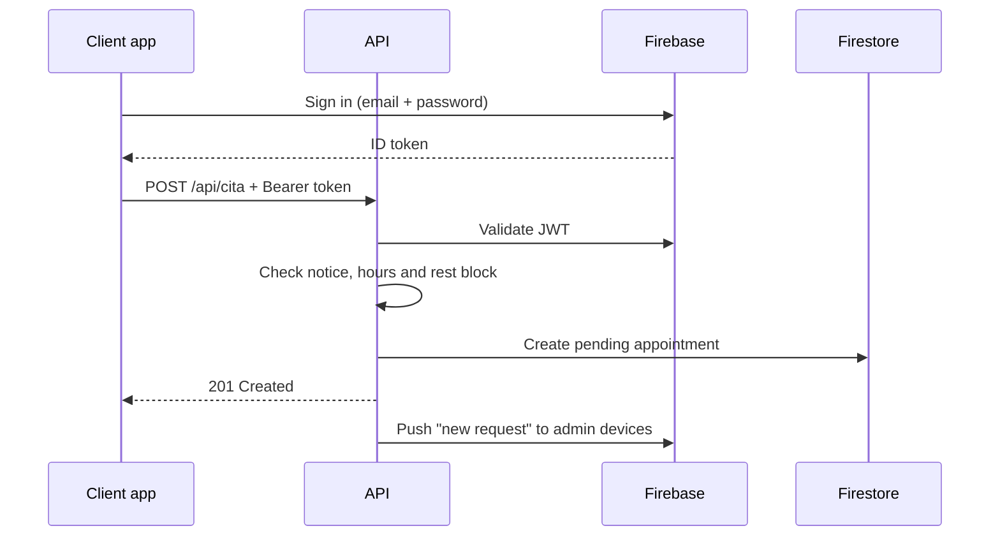

# DulceRelax

Massage booking system with an ASP.NET Core API and two .NET MAUI apps (client and
admin), featuring Firebase authentication, offline support and push notifications.

[English](README.md) · [Español](README.es.md)

> Screenshots are pending capture. The checklist and file names live in
> [`docs/screenshots`](docs/screenshots/README.md).

## Overview

Clients book a massage at home by choosing a service, date, time and address. Admins
confirm, reschedule or cancel requests from a daily agenda. The API owns the business
rules; the two apps consume them.

This is a complete product rather than a CRUD demo: authentication, role-based access,
offline mode, local reminders, push notifications and a deployed API. I built the API,
the data model and the business rules, and implemented the two MAUI clients on top of
that flow.

## Features

### Client app

- Sign up and sign in with email and password, plus password recovery
- Service catalog with price, duration and description
- Booking with address, phone and access notes
- Edit or cancel pending appointments
- "My appointments" with pending, confirmed and cancelled states
- Profile editing (name, phone, address)

### Admin app

- Sign in restricted to accounts with the `admin` claim
- Daily agenda with previous/next day and a shortcut to today
- Confirm or cancel requests
- Create and edit services and their availability
- Customer list
- Weekly business hours configuration
- Offline mode for confirmed appointments already cached on the device
- Push notifications for new and cancelled requests
- Reminder when a request is still pending close to the appointment date

## Tech stack

| Layer | Technology |
| --- | --- |
| API | ASP.NET Core 9 Web API, Firebase Admin SDK |
| Auth | Firebase Authentication (JWT) |
| Data | Cloud Firestore |
| Apps | .NET MAUI 9 (Android), CommunityToolkit.Mvvm |
| Offline | SQLite in the admin app |
| Push | Firebase Cloud Messaging |

## Architecture

Four projects:

| Project | Type | Responsibility |
| --- | --- | --- |
| `DulceRelax.API` | ASP.NET Core Web API | REST controllers, Firestore access, business rules, push |
| `DulceRelax.Shared` | Class library | DTOs, `CitaRules`, shared API settings |
| `DulceRelax.App.Cliente` | .NET MAUI | Client app |
| `DulceRelax.App.Admin` | .NET MAUI | Admin app |

The apps do not share UI. Each one has its own `Services/`, `ViewModels/` and `Views/`,
and reuses the DTOs and rules from `DulceRelax.Shared`.



Request flow: app → API → Firestore. Firebase issues and validates the tokens.

## Business rules

The rules live in `DulceRelax.Shared/CitaRules.cs` and are covered by unit tests.

- A booking needs at least 5 days of notice.
- Confirmed appointments keep a one-hour rest block around them.
- The appointment must fit inside the business hours of that weekday, measured in the
  business time zone.
- The duration comes from the service; when it is missing, it is 60 minutes.
- Clients can only edit pending appointments and can only cancel.
- The weekly schedule must include all seven days.

The API is the source of truth. The client repeats the notice and schedule checks only
to give feedback before sending the request.

## Getting started

### Prerequisites

- .NET 9 SDK
- MAUI workload: `dotnet workload install maui-android`
- Android SDK and a device or emulator
- A Firebase project with email/password authentication, Firestore and Cloud Messaging

### Configure the API

The API reads Firebase settings from configuration. In development, use user secrets:

```bash
cd DulceRelax.API
dotnet user-secrets set "Firebase:ProjectId" "<project-id>"
dotnet user-secrets set "Firebase:CredentialsJson" "$(cat /path/to/serviceAccountKey.json)"
dotnet user-secrets set "Firebase:WebApiKey" "<web-api-key>"
```

| Key | Purpose |
| --- | --- |
| `Firebase:ProjectId` | JWT issuer and audience |
| `Firebase:CredentialsJson` | Service account JSON for Firestore and Firebase Admin |
| `Firebase:WebApiKey` | Sign-in, password recovery and token refresh |
| `Negocio:ZonaHoraria` | Business time zone (default `America/Managua`) |

The `.gitignore` already excludes service account files, `google-services.json`, local
settings and keystores. Never commit them.

### Run the API

```bash
dotnet run --project DulceRelax.API
```

The `http` profile listens on `http://localhost:5082`; the `https` profile also uses
`https://localhost:7204`. In Development the OpenAPI document is exposed. Deployment
steps for Render and Fly are in [`docs/deployment.md`](docs/deployment.md).

### Build the apps

```bash
dotnet build DulceRelax.App.Cliente -f net9.0-android
dotnet build DulceRelax.App.Admin -f net9.0-android
```

The apps read the API address from `DulceRelax.Shared/ApiSettings.cs`. Debug builds use
`http://10.0.2.2:5082/` (the host machine from the Android emulator); Release builds use
`https://dulcerelax.onrender.com/`. You can override it at runtime with the
`api_base_url` preference.

The admin app also needs `google-services.json` in `DulceRelax.App.Admin/` for push. It
compiles without that file, but FCM does not start and no push arrives.

### Tests

```bash
dotnet test DulceRelax.Tests
```

The test project covers the booking rules: notice, business hours, time zone conversion,
default duration and the one-hour rest block.

### Android builds

Release builds are published as unsigned APKs on the
[Releases](https://github.com/Bryanrf22/DulceRelax/releases) page. On the device, enable
"install unknown apps" for the browser or file manager before installing them.

The workflow in `.github/workflows/release-apk.yml` builds both APKs when a release is
published; `ci.yml` builds the API and runs the tests on every pull request.

## API reference

See [`docs/api.md`](docs/api.md) for every endpoint, access level and error format.

## Offline mode

Only the admin app works offline.

- `LocalDb` opens `dulcerelax_admin.db3` and creates the `citas`, `clientes` and
  `cuenta_offline` tables.
- `CitaCacheService` caches confirmed appointments; `ClienteCacheService` caches
  customers. Both record the last sync in `Preferences`.
- The agenda shows cached data when the network fails and the requested day is covered.
  Coverage includes today and tomorrow.
- `CuentaOfflineService` allows sign-in without network. The password is stored as
  PBKDF2-SHA256 with 600,000 iterations, a 16-byte salt and a 32-byte hash, and compared
  in constant time. The admin must have signed in on that device before.
- `RedHandler` wraps network errors; statuses `502`, `503` and `504` count as server
  unavailable.

## Notifications

| Notification | Source | Mechanism | Works offline |
| --- | --- | --- | --- |
| Confirmed appointment reminder | Admin app | Local notification scheduled 1 day and 1 hour before | Yes |
| New appointment request | API | FCM push | No |
| Appointment cancelled by client | API | FCM push | No |
| Request still pending near the date | API | FCM push from a `BackgroundService` | No |

Local reminders are recalculated on every sync, so a cancelled appointment loses its
reminder. Push notifications are sent by `PushSender` with the Firebase Admin SDK.

`AvisoLimiteWorker` checks pending appointments every hour and warns when the appointment
is less than seven days away.

> **Hosting caveat:** a `BackgroundService` only runs while the API is awake. If the host
> scales to zero, move the check to a protected endpoint called by an external scheduler.

## Design decisions

- **Firebase instead of a custom auth server.** It provides email/password auth, JWTs,
  password recovery and FCM without maintaining identity infrastructure.
- **Offline only in the admin app.** That is where an unstable connection costs money;
  the client app can ask the customer to retry.
- **Business rules in the API, repeated in the client for early feedback.** The API
  remains the authority, but the user does not fill a form only to get a rejection.
- **Shared rules in `CitaRules`.** Extracting the rules removed the drift between the API
  and the client and made them testable without Firestore.
- **SQLite cache only for confirmed appointments.** Caching every request would make the
  agenda lie about what is actually booked.

## What I would change

- Replace `AvisoLimiteWorker` with an external scheduler or a queue so reminders do not
  depend on the API staying awake.
- Add integration tests around the controllers and Firestore emulator.
- Sign the Android APKs with a real keystore before distributing them.
- Move the service catalog images from the app bundle to storage when the catalog grows.
- Add an admin screen for the API address instead of relying on the `Preferences` key.

## Known limitations

- Unit tests cover the business rules, not the UI or the API integration.
- The API runs on a free host that can scale to zero.
- Android only.
- The published APKs are unsigned.

## Privacy

The app handles names, phone numbers and home addresses because the service is delivered
at the customer's home. This repository contains no production data and no credentials.
Screenshots use fictional data only.

## License

Proprietary. Copyright © 2026 Bryan Romero. All rights reserved. The source is public for
portfolio review; it is not open source. See [`LICENSE`](LICENSE).

## Credits

The UI icons use Google's **Material Icons** font
(https://github.com/google/material-design-icons), distributed under the Apache License
2.0.
